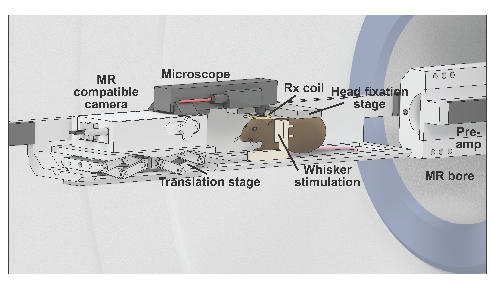

# Project
MRI compatible miniaturized fluorescence microscope

# Description
Open_mrscope includes all the 3D models and protocols to build your own MRI compatible fluorescence microscope combined (functional) MRI and calcium imaging. The open_mrscope is an open-source project published at Ubaghs et al., "Simultaneous single-cell calcium imaging of neuronal population activity and brain-wide BOLD fMRI." bioRxiv(2023): 2023-11 (_https://www.biorxiv.org/content/10.1101/2023.11.14.566368v1_).

Using this repository, everyone can build and evaluate their own MRI compatible microscope to not only record brain-wide functional neurovascular activity, but also calcium activity at the single-cell level. Please also see related repositories for more tools to perform MRI compatible combined recordings (MR compatible, water cooled, translational stage: https://github.com/rlemubaghs/open_mr_translation_stage; MR compatible mouse cradle for combined recordings: _https://github.com/rlemubaghs/open_mr_cradle_mouse_)! 

# Contents
1. Open_mrscope_mk2

Here you can find the 3D models of all the components necessary for building the MR compatible fluorescence microscope. 

2. Documentation
   
- Order_list
This document lists all the necessary components, and where to buy/how to produce them.
- Build_instructions
This document gives a detailed description of how to build your own microscope.

3. Dependencies

The assembly is dependent on the open_screws repository (_https://github.com/rlemubaghs/open_screws_). 

4. Deprecated

Here you can find the 3D models of the previously used 3D printed MRI compatible microscope. We found that this model suffers from durability issues, and it is not recommended to use this version. Please use the new CNC producible version.

# Credits
This repository was created by Rik Ubaghs and maintained by the Grewe group at the Institute for Neuroinformatics (University and ETH Zurich). For full list of contributors, please refer to the paper Ubaghs et al., "Simultaneous single-cell calcium imaging of neuronal population activity and brain-wide BOLD fMRI." bioRxiv(2023): 2023-11 (_https://www.biorxiv.org/content/10.1101/2023.11.14.566368v1_).

The open_mrscope is an open-source project, and we encourage people to use, test, modify these tools. If you have any questions, suggestions, or find any bugs, please contact us or submit an issue. If you use the project, please cite us!
